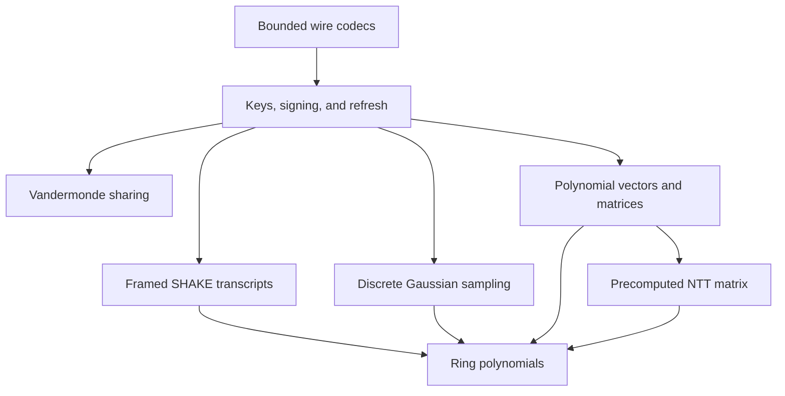

# Architecture

The crate separates algebra, sampling, transcript extraction, and protocol state.
All public inputs have explicit parameters. Construction validates dimensions and
canonical representatives; higher layers apply the corresponding protocol checks.

| Module | Responsibility |
| ---- | ---- |
| `ring` | Canonical residues, negacyclic multiplication, rounding, centered norms, NTT |
| `linear` | Bounded matrix/vector arithmetic and reusable public matrix transforms |
| `sampling` | Fallible exact-rational Gaussian sampling and unbiased residues |
| `sharing` | Figure 5 paths, sharing, recovery, consistency, and allocation counts |
| `transcript` | Versioned SHAKE framing and unbiased challenge/binding extraction |
| `parameters` | Explicit profile validation and conservative integer correctness bounds |
| `protocol` | Private implementation of the re-exported key, signing, and refresh APIs |
| `wire` | Canonical packets pinned to caller-selected parameters and resource limits |

`PublicKey` holds A, its transform, the rounded verification vector, and the
parameter profile. `PublicKeyPackage` adds immutable per-epoch verification shares.
Packages share the long-term key through `Arc`; private shares have unique owners.

`SecretShare::preprocess` burns its lifetime reservation before sampling.
`NonceState` owns the secret masks, is not Clone, and is consumed by signing.
Public commitments and signing requests can be cloned. The request validates all
common inputs once, then holds derived binding factors, commitments, and challenge
for signers and verifiers to reuse.

Refresh proposals are untrusted public data. Global verification produces a
`VerifiedRefresh`; individual verification checks each confidential update's
secret/error norm. Updates allocate replacements before mutating state. Epoch
and package identities prevent old nonces and tokens from applying to new state.
`KeySet::apply_refresh` extends this transaction to an in-process committee.

The implementation uses ordinary safe Rust ownership and error propagation;
unsafe code is forbidden. Private polynomial storage zeroizes on drop. Arithmetic
is intentionally a correctness backend with explicit variable-time behavior.
The public API uses modules and re-exports rather than restricted `pub(...)`
visibility. Randomness stays caller-owned through `TryCryptoRng`.

The paper-to-API mapping and operational responsibilities are in `PROTOCOL.md`;
packet details are in `WIRE.md`. Transport authentication, durable nonce recovery,
dealerless DKG, and cryptanalytic certification are separate from the implemented
paper algorithms.
